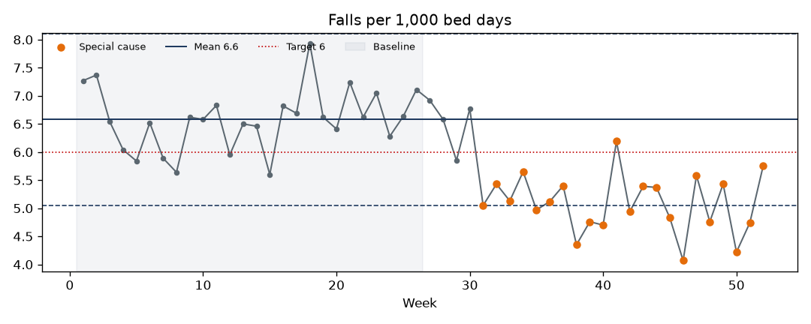
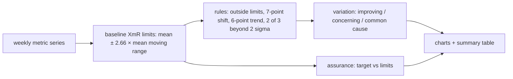

# SPC Control Charts

[](https://github.com/Saigwe/spc-control-charts/actions/workflows/ci.yml)
 

Statistical Process Control (SPC) for improvement measurement, in the style of NHS England's *Making Data Count*. It builds XmR (individuals and moving range) charts, applies the special-cause rules and says, for each metric, whether variation is improving, concerning or just noise, and whether the process can reliably hit its target.





## Result on the sample data

| Metric | Variation | Assurance | What it means |
|---|---|---|---|
| Falls per 1,000 bed days | special cause - improving | hit and miss | The falls programme (week 30) worked, but the process still won't reliably stay under target |
| Complaints answered within 25 days (%) | common cause | hit and miss | Nothing has changed; hitting 85% depends on luck, so the process itself needs redesign |
| Incidents awaiting review | special cause - concerning | no target | A growing backlog since week 40 needs action now |

The full report with all three charts is in [`output/report.md`](output/report.md).

## How the rules work

- **Limits:** calculated on a 26-week baseline and projected forward, so later changes show as special cause instead of being absorbed into the limits.
- **Special-cause rules:**
  - a point outside the limits
  - a run of 7 or more points on one side of the mean
  - 6 or more points steadily increasing or decreasing
  - 2 of 3 points beyond 2 sigma on the same side
- **Variation icon:** based on the most recent special cause and whether higher is better for that metric.
- **Assurance icon:** compares the target with the process limits (always inside, always outside, or in between).

## Run it

```bash
pip install -r requirements.txt
python -m spc.report      # writes output/report.md and one chart per metric
pytest
```

The tests cover each rule's edge cases (6 vs 7 points, 5 vs 6 trend points), metric direction (higher or lower is better), the assurance logic, and an end-to-end check that the planted signals are detected.

## Stack

Python, matplotlib, pytest.
