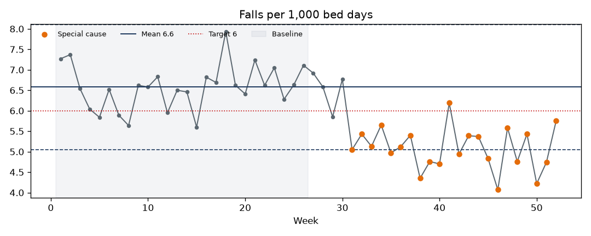
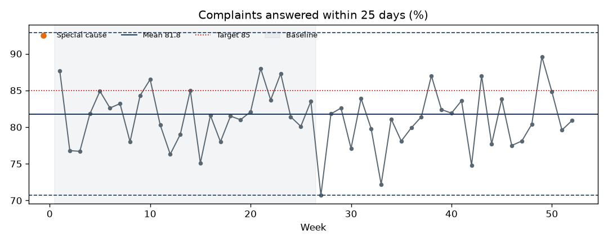
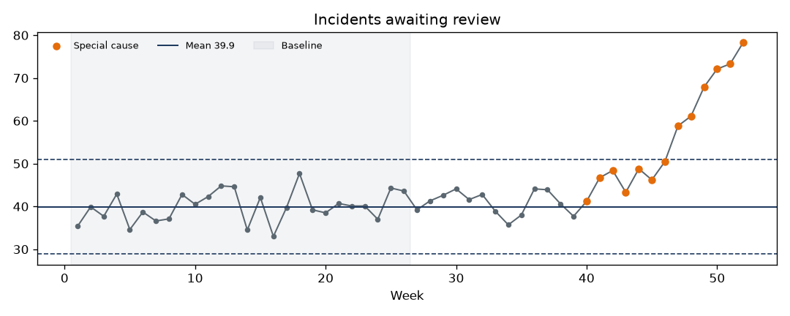

# Quality metrics: SPC summary

Limits are calculated from the first 26 weeks (baseline) and projected forward, so later changes show up as special cause.

| Metric | Latest | Mean | Lower limit | Upper limit | Variation | Assurance |
|---|---|---|---|---|---|---|
| Falls per 1,000 bed days | 5.75 | 6.58 | 5.05 | 8.11 | special cause - improving | hit and miss |
| Complaints answered within 25 days (%) | 80.9 | 81.78 | 70.7 | 92.87 | common cause | hit and miss |
| Incidents awaiting review | 78.3 | 39.94 | 28.87 | 51.0 | special cause - concerning | no target |

### Falls per 1,000 bed days

### Complaints answered within 25 days (%)

### Incidents awaiting review

